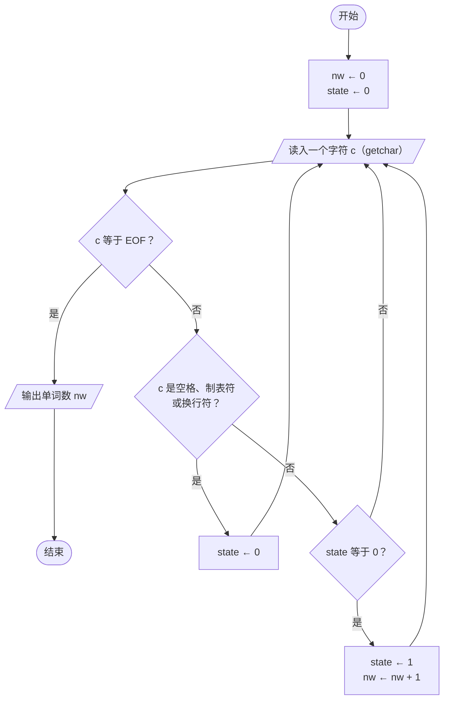
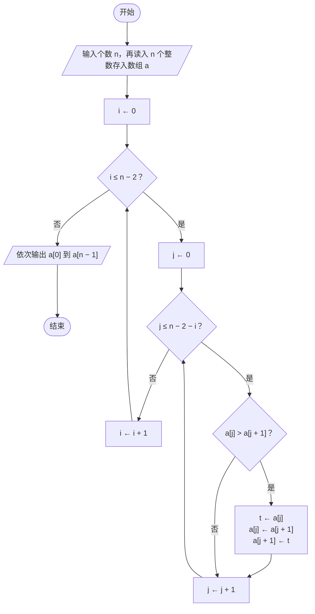

# Lab 6 书面作业参考答案

单词统计与冒泡排序法的 C 参考程序和流程图。

<!-- more -->

## 1. 单词统计

从标准输入逐字符读取，直到遇到 `EOF`，输出单词总数。空格、制表符和换行符是分隔符，每一段连续的非分隔字符算一个单词。

### 参考代码

```c
#include <stdio.h>

int main(void) {
    int nw = 0;
    int state = 0;
    int c;

    c = getchar();
    while (c != EOF) {
        if (c == ' ' || c == '\t' || c == '\n') {
            state = 0;
        } else if (state == 0) {
            state = 1;
            nw++;
        }
        c = getchar();
    }

    printf("%d\n", nw);
    return 0;
}
```

### 流程图



`state` 为 `0` 表示在单词外，为 `1` 表示在单词内。读到新单词的第一个字符时计数一次，所以连续的分隔符不会多计，末尾没有分隔符的单词也不会漏计。

## 2. 冒泡排序法

先输入整数个数 `n`（`1 ≤ n ≤ 100`），再输入 `n` 个整数，依次存入 `a[0]` 到 `a[n - 1]`，最后按从小到大的顺序输出。课件中的 10 个整数取 `n = 10`。

### 参考代码

```c
#include <stdio.h>

int main(void) {
    int a[100];
    int n;
    int i, j, t;

    scanf("%d", &n);
    for (i = 0; i < n; i++) {
        scanf("%d", &a[i]);
    }

    for (i = 0; i < n - 1; i++) {
        for (j = 0; j < n - 1 - i; j++) {
            if (a[j] > a[j + 1]) {
                t = a[j];
                a[j] = a[j + 1];
                a[j + 1] = t;
            }
        }
    }

    printf("%d", a[0]);
    for (i = 1; i < n; i++) {
        printf(" %d", a[i]);
    }
    printf("\n");
    return 0;
}
```

### 流程图



第 `i + 1` 趟从左向右比较相邻元素，共比较 `n - 1 - i` 次，把当前未排序部分的最大值移到 `a[n - 1 - i]`。共进行 `n - 1` 趟。
